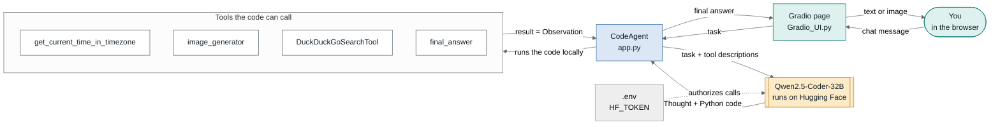
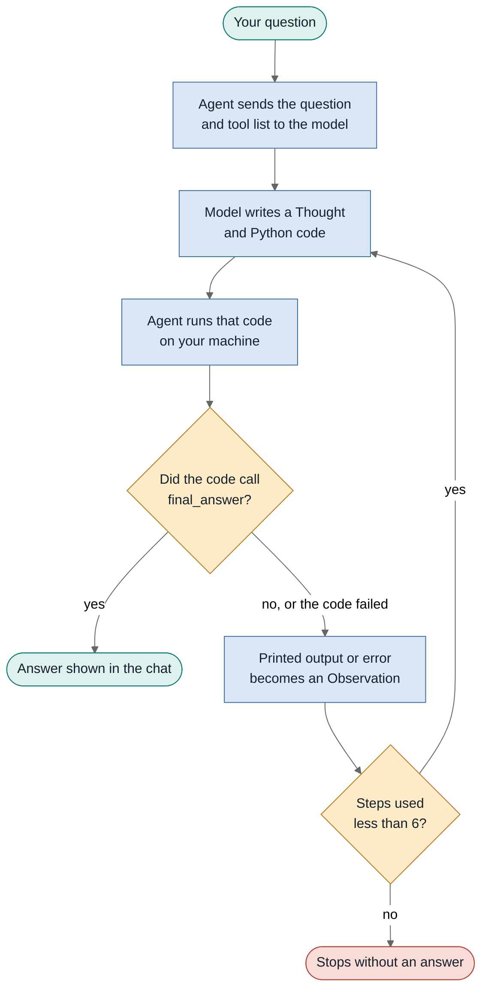
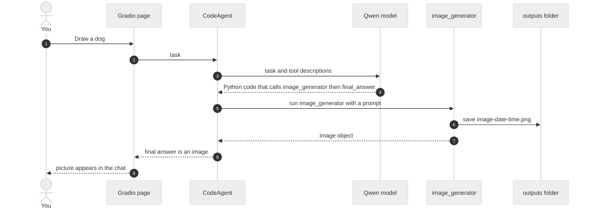

# How the agent works

Three views of `src/huggingface_agent/app.py`: who talks to whom, the loop the agent repeats, and one real request.

The model never runs anything itself. It writes Python, the local machine runs it, and the result goes back to the model.

## 1. Parts and who talks to whom

Green: what you see. Blue: the agent that does the work. Amber: the model, which only thinks. White: the tools it may call. The dotted line is the Hugging Face token from `.env`.

## 2. The loop inside one question

The agent repeats think, code, run, observe until the code calls `final_answer`, or until it hits `max_steps=6`.

Errors are not fatal: a failed run is fed back as an Observation, so the model gets another try until the step limit.

## 3. One real request: "Draw a dog"

The picture is made by the tool, not by the model. A copy is saved to `outputs/` with a timestamp.

## Where each part lives

| Part | File or setting | Job |
|---|---|---|
| Chat page | `Gradio_UI.py` | Shows steps, text and images at `127.0.0.1:7860` |
| Agent and tools | `app.py` | Creates the `CodeAgent`, defines the tools, loads the image tool |
| Model | `InferenceClientModel` | Calls Qwen2.5-Coder-32B on Hugging Face |
| Token | `.env` → `HF_TOKEN` | Read by `load_dotenv()`, used automatically by the model client |
| Step limit | `max_steps=6` | Stops the loop so it cannot run forever |
| Saved images | `outputs/` | Every generated image is copied here with a timestamp |
