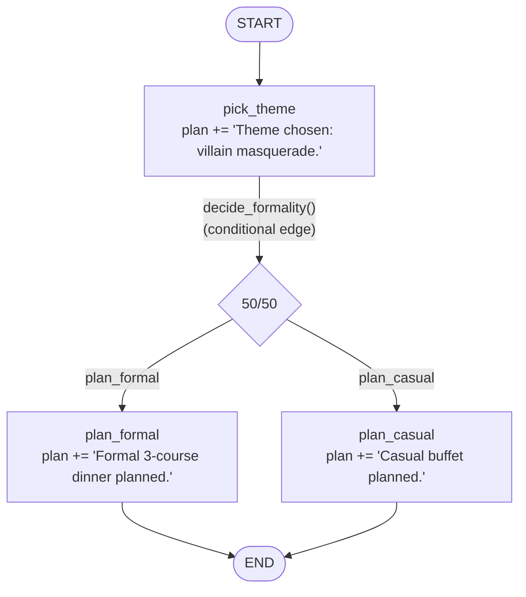

# Building Blocks

Course page: https://huggingface.co/learn/agents-course/en/unit2/langgraph/building_blocks

LangGraph's core building blocks: **State** (a `TypedDict`), **Nodes** (plain functions that return partial state updates), **Edges** (direct or conditional), and **`StateGraph`** (the container you build, compile, and invoke).

## Files

- **`party_graph.py`** — `PartyPlanningGraph`, plus the module-level `PartyState`, node functions, and routing function the class assembles.

## Run it

```
python -m huggingface_agent.langgraph_course.building_blocks.party_graph
```

## The graph



## What each piece actually does

- **`PartyState(TypedDict)`** — the *only* thing that moves between nodes. Nodes never see each other's local variables or call each other directly; they only read/write this shared state.
- **Nodes** (`pick_theme`, `plan_formal`, `plan_casual`) — plain functions, `state -> dict`. Each returns a **partial update** (just `{"plan": ...}`), not the whole state — LangGraph merges it back in automatically.
- **`decide_formality`** — a conditional edge's routing function. Its `Literal["plan_formal", "plan_casual"]` return type isn't just documentation — LangGraph uses it to know what the valid destinations are.
- **`StateGraph(PartyState)` → `add_node` / `add_edge` / `add_conditional_edges` → `compile()`** — assembly happens once, in `PartyPlanningGraph.__init__`; `compile()` produces the actual runnable graph, stored as `self.graph`.
- **`graph.invoke({"plan": initial_plan})`** — runs the whole thing start to end in one call, returning the final merged state dict.

## What we verified hands-on

Ran `PartyPlanningGraph` twice in a row — the conditional edge genuinely branched differently each time:
```
run 1: ---pick_theme---  ---plan_casual---  -> "...Casual buffet planned."
run 2: ---pick_theme---  ---plan_formal---  -> "...Formal 3-course dinner planned."
```
Confirms `decide_formality`'s random routing is real, not just structurally present but unused.

## Visualization — opt-in, not automatic

`PartyPlanningGraph.visualize()` wraps the course's `graph.get_graph().draw_mermaid_png()` — **this sends the graph's structure to the public `mermaid.ink` API** to render the PNG. It's not called in `__main__` for that reason (an external network call to a third-party service shouldn't happen silently). Call `planner.visualize()` yourself if you're fine with that.
