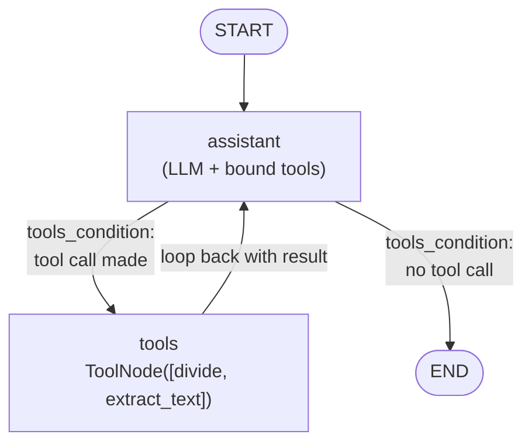
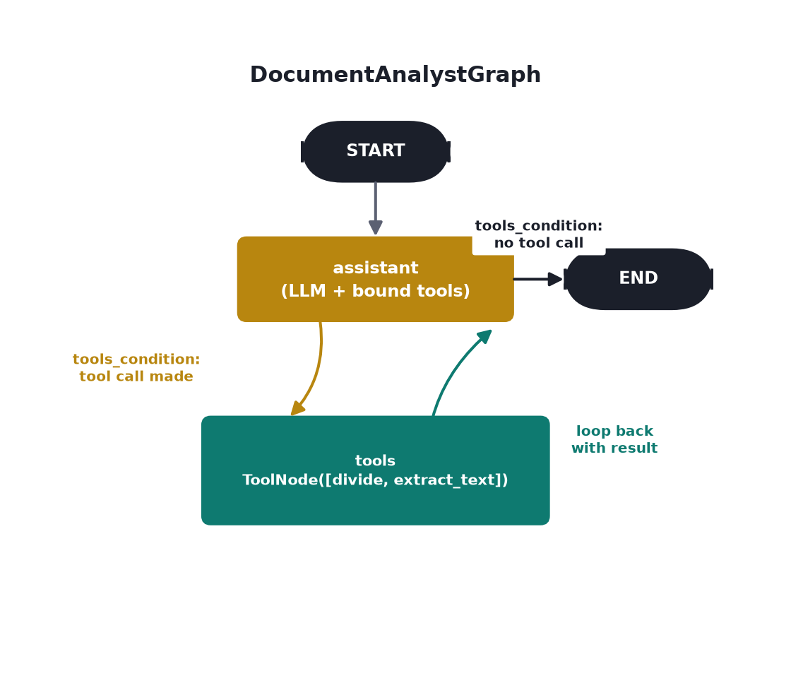

# Document Analysis Agent

Course page: https://huggingface.co/learn/agents-course/en/unit2/langgraph/document_analysis_agent

"Alfred, the document analyst agent" — the course's first **real agent** in LangGraph (contrast with `first_graph/`'s fixed pipeline): a ReAct-style `assistant ↔ tools` loop via `tools_condition`, with a calculator tool and a real vision-based text-extraction tool.

## Files

- **`document_analyst_graph.py`** — `DocumentAnalystGraph`, `AgentState`, `generate_training_note_image()`.

## Run it

```
python -m huggingface_agent.langgraph_course.document_analysis_agent.document_analyst_graph
```

## The loop





Unlike `MailSortingGraph`'s fixed `read → classify → branch → notify` path, this graph has no predetermined route — `tools_condition` (built into LangGraph) checks whether the model's latest message contains a tool call. If yes, go to `tools` and come back; if no, the model judged it has enough to answer, so stop. The model itself decides how many loop iterations it needs.

## One model for both roles

Same model, `meta-llama/Llama-4-Scout-17B-16E-Instruct`, serves as both the vision model (inside `extract_text`) and the tool-calling assistant — matching the course's single `gpt-4o` doing both jobs. Confirmed both capabilities work on this model before building anything around it (see `smolagents_course/vision_and_browser_agents/` for where the vision half was first verified).

## A real bug, found and fixed: dropped `parallel_tool_calls=False`

The course passes `llm.bind_tools(tools, parallel_tool_calls=False)` — `ChatOpenAI` forwards that to OpenAI's API, which supports it. `ChatHuggingFace` forwards it just as blindly, straight to `huggingface_hub`'s `InferenceClient.chat_completion()`, which doesn't accept it at all:
```
TypeError: InferenceClient.chat_completion() got an unexpected keyword argument 'parallel_tool_calls'
```
Fixed by dropping the argument entirely (`llm.bind_tools(self.tools)`). In practice the model still issued one tool call per step regardless — `parallel_tool_calls=False` just isn't expressible through this backend.

## What we verified hands-on

- **Calculation, no file**: `"Divide 6790 by 5"` → the assistant called `divide(a=6790, b=5)`, looped back, and answered `"...is 1358."` — correct.
- **Document question**: `generate_training_note_image()` draws a real note (no external image needed) with a dinner shopping list. Asked *"what's the list of items I should buy for the dinner menu?"* with that image as `input_file` → the assistant called `extract_text(img_path=...)`, which genuinely OCR'd the image via the vision model, and the final answer listed **salmon fillets, asparagus, sweet potatoes, dark chocolate (70%)** — an exact match to what was actually drawn in the image, not a guess.

Both runs exercised the real loop: tool call → `ToolNode` executes it → result appended to `messages` → back to `assistant` → model decides it has enough → `END`.
