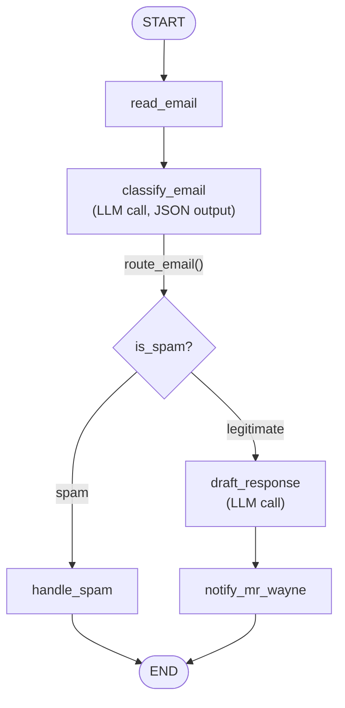
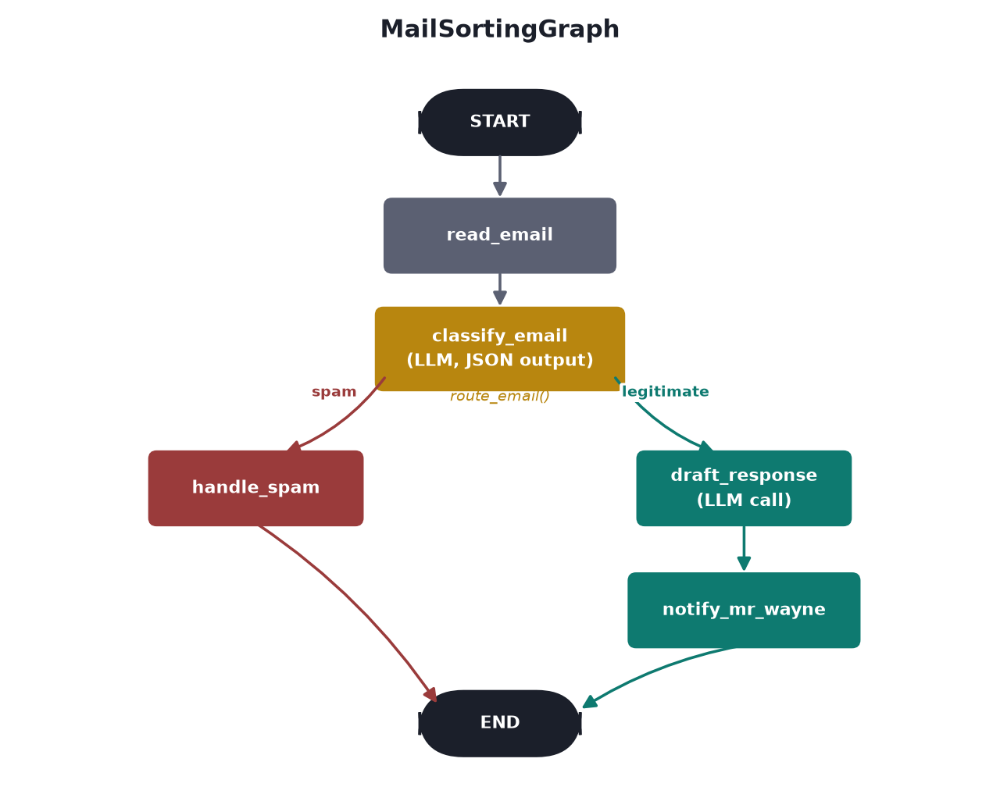

# First Graph

Course page: https://huggingface.co/learn/agents-course/en/unit2/langgraph/first_graph

"Alfred, the mail sorting butler" — the course's first graph with real LLM nodes, not just string concatenation (contrast with `building_blocks/`). The page explicitly calls this *not* a true agent, since no tools are involved — just LLM calls wired into a fixed graph structure.

## Files

- **`mail_sorting_graph.py`** — `MailSortingGraph`, `EmailState`.

## Run it

```
python -m huggingface_agent.langgraph_course.first_graph.mail_sorting_graph
```

## The graph





Rendered locally with matplotlib rather than LangGraph's own `draw_mermaid_png()` — that method sends the graph's structure to the public `mermaid.ink` API (same reason it's opt-in, not automatic, in `building_blocks/`).

## Two deliberate deviations from the course page

1. **`ChatHuggingFace`/`HuggingFaceEndpoint` instead of `ChatOpenAI`** — no OpenAI key needed, consistent with every other framework example in this project (smolagents, LlamaIndex).
2. **JSON classification output instead of keyword search.** The course's own code parses the model's free-text reply by searching for the literal words `"spam"` and `"reason:"` — fragile: a *legitimate* email that happens to contain the word "spam" (e.g. "please stop the spam calls I keep getting") would misclassify. This version asks the model for a JSON object (`is_spam`, `spam_reason`, `category`) instead, with a safe fallback (`is_spam: False`) if parsing ever fails rather than crashing.

Also: the course's code notifies "Mr. Hugg" despite the surrounding text describing "Mr. Wayne." This version uses **Mr. Wayne** throughout — also the canonically correct name for Alfred's employer, matching the Wayne Manor theme already used across this project.

## A real bug, found and fixed: `provider="featherless-ai"`

Initially worked, then later failed with `BadRequestError: ... 'Qwen/Qwen2.5-Coder-32B-Instruct' is not supported by any provider you have enabled` — reproduced consistently, not a one-off. Same root cause as the vision-model issue in `smolagents_course/vision_and_browser_agents/`: `model_info(..., expand="inferenceProviderMapping")` confirmed the model's *only* live provider right now is `featherless-ai`, which isn't enabled by default on this account. `HuggingFaceEndpoint`'s provider auto-resolution doesn't fall back to it on its own. Fixed by passing `provider="featherless-ai"` explicitly in `_build_llm`. Worth knowing: a model that was working can stop working later if its set of live providers changes — check `model_info` rather than assuming the model itself is broken.

## What we verified hands-on

Ran both branches for real:

- **Legitimate email** (`"Question about your services"`) → classified as `category: "request"`, a genuinely well-drafted reply generated, correctly routed through `draft_response` → `notify_mr_wayne`. The model independently signed the draft *"Alfred P. Wayne, Butler to Bruce Wayne"* — picking up on the Alfred/Wayne framing itself, not from any hardcoded signature in the prompt.
- **Spam email** (`"YOU HAVE WON $5,000,000!!!"`) → classified as spam with a sensible reason (*"Unsolicited lottery win notification requiring personal financial information"*), correctly short-circuited straight to `handle_spam` — `draft_response` and `notify_mr_wayne` never ran for it.

Both runs' JSON classification parsed cleanly on the first attempt — the safe-fallback path (`is_spam: False` on parse failure) exists for robustness but wasn't needed in these runs.
