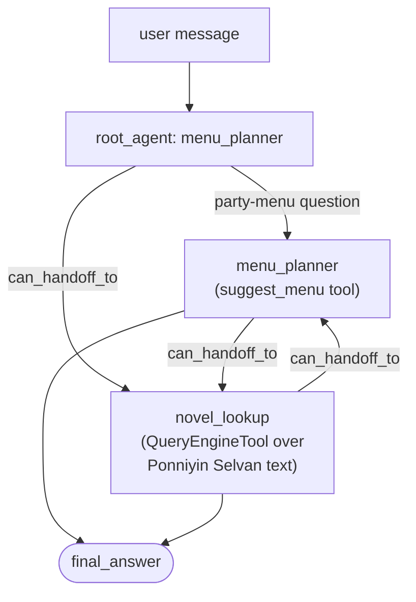

# Agents

Course page: https://huggingface.co/learn/agents-course/en/unit2/llama-index/agents

LlamaIndex's `AgentWorkflow`: basic tool-using agents, stateful conversation via `Context`, RAG agents, and multi-agent systems with handoff.

## Files

- **`party_agents.py`** — `build_basic_agent()`, `demo_memory()`, `build_rag_agent()`, `build_multi_agent_system()`. The RAG and multi-agent examples reuse the real tools from `tools/party_tools.py` rather than rebuilding anything.

## Run it

```
python -m huggingface_agent.llamaindex_course.agents.party_agents
```

## Multi-agent handoff



Each agent only needs tools for its own specialty; `can_handoff_to` lets it route a question outside that specialty to the other agent instead of trying (and failing) to answer it directly.

## A real bug, found and fixed: `ReActAgent(..., streaming=False)`

`ReActAgent` defaults to `streaming=True`. Traced into both libraries' source to confirm: that path (`take_step` → `_get_streaming_response` → `llm.astream_chat`) reliably hit `RuntimeError: Cannot send a request, as the client has been closed.` — reproduced with two different models, so not a function-calling-support issue. `astream_chat()` called directly, in isolation, works fine — the bug is specifically in how the agent workflow engine drives *repeated* streaming calls across steps. `streaming=False` routes through `_get_response` (plain `llm.achat()`) instead, which has no such issue. All agents in `party_agents.py` set this explicitly.

## A real, non-deterministic limitation (not fixed, documented)

During testing, one run of `demo_memory()`'s first turn (a plain statement, not a question) hit `WorkflowRuntimeError: Max iterations of 20 reached!` — the model failed to produce output `ReActOutputParser` could parse, enough times to exhaust the retry budget. Re-running the *exact same code* immediately after succeeded normally. This is inherent LLM non-determinism in producing strict ReAct-format output (`Qwen2.5-Coder-32B-Instruct` is a coding model, not fine-tuned specifically for agentic ReAct formatting) — not something a code fix resolves. Worth knowing if you see this error: it's usually transient, not a sign something is broken.

## What we verified hands-on

- **Basic agent**: `suggest_menu` tool called correctly for "a casual party."
- **Memory**: a two-turn conversation via one `Context` — turn 2 ("suggest a menu for my favorite occasion") correctly used "superhero" remembered from turn 1, with no repeated statement needed.
- **RAG agent**: correct, grounded answers about Vandiyathevan and Kundavai from the real Tamil novel text (Kundavai's description — "daughter of Chembian Maadhevi... royal lineage" — matches the character's real role in the novel).
- **Multi-agent handoff**: a menu question and a novel question, sent to the same `AgentWorkflow`, each correctly routed to the agent actually equipped to answer it.
