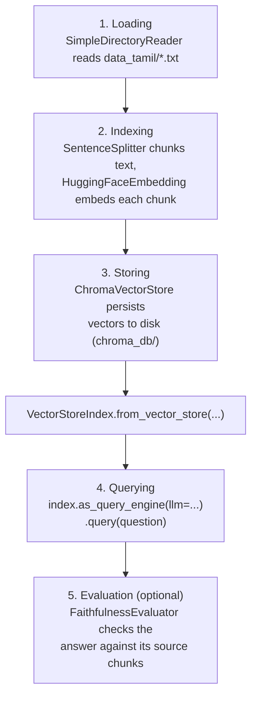
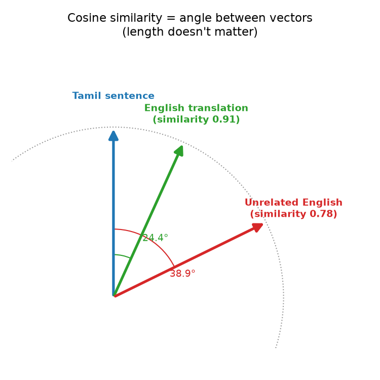

# Components

Course page: https://huggingface.co/learn/agents-course/en/unit2/llama-index/components

LlamaIndex's building blocks for giving an agent access to real data via RAG — the `QueryEngine`. Covers five stages: Loading, Indexing, Storing, Querying, Evaluation.

## Files

- **`data/`** — the original small knowledge base about Wayne Manor parties (`calendar.txt`, `dietary_preferences.txt`, `past_menus.txt`), kept for reference but no longer the default.
- **`data_tamil/`** — real Tamil-language novel text (3 chapters of *Ponniyin Selvan* by Kalki Krishnamurthy), the current default — see **Attribution** below.
- **`party_query_engine.py`** — `PartyQueryEngine`, wrapping all five stages.
- **`cosine_distance.png`** — diagram explaining the similarity metric behind step 4 (see below).

## Run it

```
python -m huggingface_agent.llamaindex_course.components.party_query_engine
```

## The five stages



This is the **semantic** counterpart to `smolagents_course/retrieval_agents`' BM25 example — that one matched keywords; this one matches meaning via embedding vectors, through a real persistent vector store instead of an in-memory index.

## Why Tamil text, and why a different embedding model

The original plan was to test this against a PDF of *Ponniyin Selvan*, dropped into `docs/`. That PDF turned out to use a **broken legacy Tamil font encoding** — the glyphs render correctly in a PDF viewer, but raw text extraction (what `SimpleDirectoryReader` does) pulls out garbled, meaningless character sequences instead of real Tamil. `data_tamil/*.txt` instead comes from **Project Madurai**'s proper Unicode edition (see Attribution).

Separately, `BAAI/bge-small-en-v1.5` (the original embedding model) is **English-only** and produces poor embeddings for Tamil. `intfloat/multilingual-e5-small` replaces it — confirmed working for real cross-lingual retrieval (see `cosine_distance.png`: a Tamil sentence and its English translation scored **0.91** cosine similarity vs. **0.78** for an unrelated English sentence).



## What we verified hands-on

**Cross-lingual retrieval, for real**: asking *"Who is Vandiyathevan and what is he doing at the lake?"* **in English** correctly retrieved and synthesized an answer from the **Tamil** source text — no translation step anywhere in the code; the embedding model itself places same-meaning sentences from different languages near each other in vector space.

**A real bug, found and fixed**: `query_and_evaluate("Is Alwar Kadiyan the main character?")` first returned an answer mentioning "Kalayan... a brave warrior of an unrighteous kingdom" — a detail that doesn't exist anywhere in the source text. `FaithfulnessEvaluator` passed it anyway (`True`), which exposed an important limit of that check: it only verifies an answer matches *whatever got retrieved*, not that retrieval itself was correct. The actual cause: `PartyQueryEngine.__init__` re-ran ingestion on every construction with no deduplication, and repeated testing had inflated the collection to **3,657 duplicate vectors** (should have been ~700-900). Fixed by checking `collection.count() == 0` before ingesting. After clearing and rebuilding clean (1,219 vectors, a sane count), the same question produced a answer that matched the real source text, verified by reading the raw chapter content directly.

**Original party-planning queries** (still valid against `data/`, not the current default):
- *"What should I serve at the villain masquerade party, given past feedback?"* → correctly pulled from `past_menus.txt`, synthesized across sentences.
- *"What wine pairs with the villain masquerade theme?"* → correctly pulled Malbec/Shiraz from `dietary_preferences.txt`, faithfulness-checked.

## Attribution

`data_tamil/*.txt` is text from *Ponniyin Selvan* by Kalki Krishnamurthy (1899–1954), sourced from [Project Madurai](https://www.projectmadurai.org/)'s free Unicode Tamil etext edition — a volunteer initiative preparing electronic texts of Tamil literary works for free distribution. Included here for educational/RAG-experimentation purposes only.
