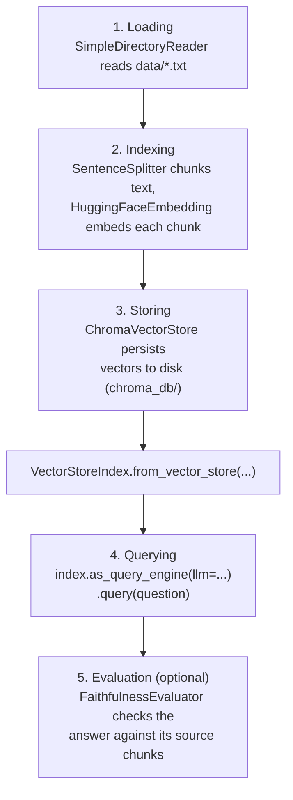

# Components

Course page: https://huggingface.co/learn/agents-course/en/unit2/llama-index/components

LlamaIndex's building blocks for giving an agent access to real data via RAG — the `QueryEngine`. Covers five stages: Loading, Indexing, Storing, Querying, Evaluation.

## Files

- **`data/`** — a small local knowledge base about Wayne Manor parties: `calendar.txt`, `dietary_preferences.txt`, `past_menus.txt`.
- **`party_query_engine.py`** — `PartyQueryEngine`, wrapping all five stages.

## Run it

```
python -m huggingface_agent.llamaindex_course.components.party_query_engine
```

## The five stages



This is the **semantic** counterpart to `smolagents_course/retrieval_agents`' BM25 example — that one matched keywords; this one matches meaning via embedding vectors, through a real persistent vector store instead of an in-memory index.

## What we verified hands-on

Two real queries against the local knowledge base, both correct and grounded in the actual source files:

- *"What should I serve at the villain masquerade party, given past feedback?"* → correctly pulled from `past_menus.txt`: Avenger Bites, Batman Brownies, Kryptonite Punch, **and** the detail that guests specifically praised the Brownies and asked for them again — synthesized across sentences, not just copied verbatim.
- *"What wine pairs with the villain masquerade theme?"* → correctly pulled Malbec/Shiraz from `dietary_preferences.txt`. `FaithfulnessEvaluator` confirmed this answer **is** supported by the retrieved source text (`passing: True`) — a real automated check, not just eyeballing the output.

## Known limitation

Re-running `PartyQueryEngine()` against an existing `chroma_db/` re-ingests the same documents into the same collection every time — fine for learning/one-off runs, but would need deduplication or a version check for a real persistent index that's rebuilt repeatedly.
