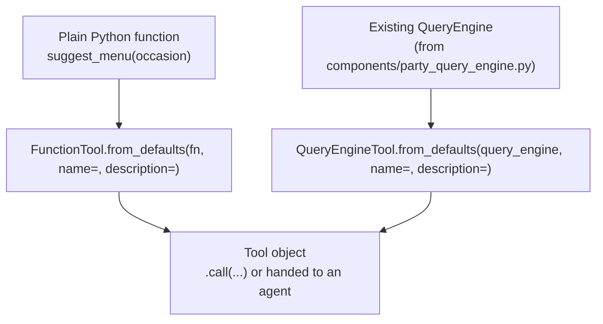

# Tools

Course page: https://huggingface.co/learn/agents-course/en/unit2/llama-index/tools

LlamaIndex's four tool types: `FunctionTool`, `QueryEngineTool`, `ToolSpec`, and utility tools (`LoadAndSearchToolSpec`, `OnDemandLoaderTool`). This folder covers the two the course page fully demonstrates with working code; the other two need external credentials or a running server not available here (same reasoning as the browser-automation half of `vision_and_browser_agents`).

## Files

- **`party_tools.py`** — `build_menu_function_tool()` and `build_novel_query_engine_tool()`.

## Run it

```
python -m huggingface_agent.llamaindex_course.tools.party_tools
```

## Two ways to make something an agent-callable tool



**`FunctionTool`** — wraps any Python function. LlamaIndex reads the function's signature + docstring the same way smolagents' `@tool` decorator does (see `code_agents/party_planner.py` for the direct comparison) — just a different framework's version of the same idea.

**`QueryEngineTool`** — wraps a *whole query engine* as one callable tool. This is the course's actual point in this section: "agents are built on query engines, so query engines can also be used as tools" — i.e. everything built in `components/` doesn't have to be the end of the pipeline, it can become one capability inside a larger agent.

## What we verified hands-on

- `build_menu_function_tool().call(occasion="superhero")` → `"Buffet with high-energy and healthy food."` — correct, same logic as the smolagents `suggest_menu` tool.
- `build_novel_query_engine_tool().call("Who is Vandiyathevan?")` → a correct, grounded answer pulled from the real Tamil novel text, reusing the exact same `PartyQueryEngine` built in `components/` rather than re-indexing anything — confirms the "reuse a query engine as a tool" pattern actually works end to end, not just in theory.

## Out of scope

- **`ToolSpec`** (e.g. `GmailToolSpec`) — needs real Gmail OAuth credentials.
- **MCP tools** (`McpToolSpec`) — needs a running MCP server at a real endpoint; the course page's own example even leaves `get_agent()` undefined.
- **Utility tools** (`OnDemandLoaderTool`, `LoadAndSearchToolSpec`) — the course page itself gives no code for these, only a description.
