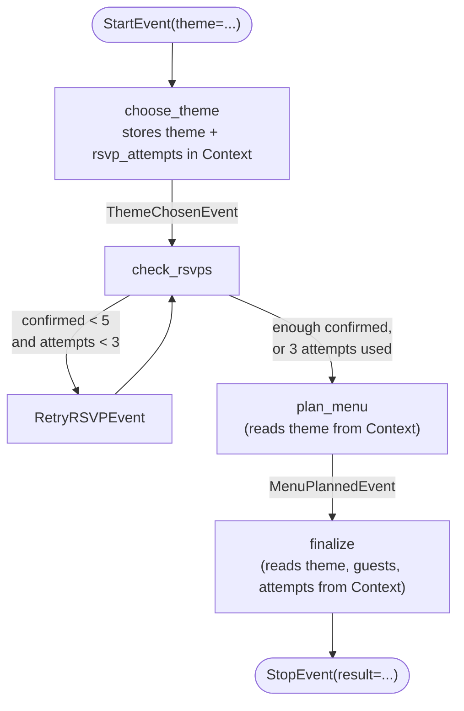

# Workflows

Course page: https://huggingface.co/learn/agents-course/en/unit2/llama-index/workflows

The raw `Workflow`/`@step`/`Event` framework that `AgentWorkflow` (used throughout `agents/`) is actually built on top of. Covers: single-step workflows, multi-step workflows with custom `Event`s, loops/branches via union type hints, `Context` state, and visualization.

## Files

- **`party_workflow.py`** — `HelloWorkflow` (simplest possible case) and `PartyPlanningWorkflow` (multi-step, loop, state, visualized).

## Run it

```
python -m huggingface_agent.llamaindex_course.workflows.party_workflow
```

## `PartyPlanningWorkflow`'s steps and loop



`check_rsvps` accepting `ThemeChosenEvent | RetryRSVPEvent` as input and returning `RSVPCheckEvent | RetryRSVPEvent` as output is the entire loop mechanism — a step whose own output type includes an event that triggers itself again. No special "loop" keyword exists; it falls directly out of the type hints.

**Why `Context` matters here, concretely**: `RetryRSVPEvent` doesn't carry `theme` — only a `message`. Without storing `theme` in `ctx.store` inside `choose_theme`, the loop would lose track of which theme was chosen every time `check_rsvps` re-triggers itself. This is the real reason `Context` exists: state that needs to survive across a loop, which no single Event in the chain carries on its own.

## What we verified hands-on

Ran with `verbose=True` and watched the actual loop happen, not just trust it works:
```
[check_rsvps:0] complete with RetryRSVPEvent   (confirmed=3, attempt 1)
[check_rsvps:0] started from RetryRSVPEvent
[check_rsvps:0] complete with RSVPCheckEvent   (confirmed=7, attempt 2)
```
Final result correctly reported `"took 2 RSVP check(s)"` — the Context-tracked attempt counter matched the real number of loop iterations observed in the trace.

**Visualization**: `visualize()` (via `llama-index-utils-workflow`'s `draw_all_possible_flows`) writes a real HTML file showing every possible path through the workflow, including the loop edge — confirmed it generates a non-trivial file (~6KB), not an empty stub.

## Scope note

The course page's steps 6/7 (`AgentWorkflow` with multiple `ReActAgent`s, `can_handoff_to`, and shared `initial_state`) are **not** rebuilt here — `agents/party_agents.py`'s `MultiAgentPartyPlanner` already covers that pattern (menu planner + novel lookup, with handoff). This folder is scoped to the lower-level `Workflow` class the course page is actually introducing.
