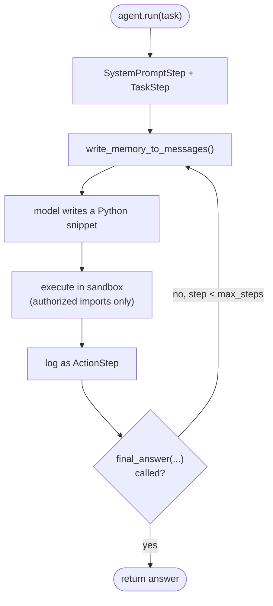

# CodeAgents

Course page: https://huggingface.co/learn/agents-course/en/unit2/smolagents/code_agents

`CodeAgent` writes and executes Python snippets to act, instead of emitting JSON tool calls. Each step: write memory as chat messages → model generates a code snippet → snippet executes in a sandbox → result logged as an observation → repeat until `final_answer(...)` or `max_steps`.

## The execution loop



## Files

- **`party_planner.py`** — `PartyPlannerAgent`, wrapping a `CodeAgent` with four tools:
  - `web_search` — built-in `DuckDuckGoSearchTool`
  - `suggest_menu` — custom, `@tool`-decorated function
  - `cityCapital` — custom, `@tool`-decorated, **deliberately always returns "Delhi"** (see below)
  - `superhero_theme_generator` — custom, `SuperheroThemeTool(Tool)` subclass
- **`tracing.py`** — `enable_console_tracing()`, a local OpenTelemetry instrumentation helper (no external Langfuse account needed) that prints structured spans for each step/tool call.

## Run it

```
python -m huggingface_agent.smolagents_course.code_agents.party_planner
```

## What we verified hands-on (not just read)

- **Sandboxing is real, not advisory**: calling a tool/import not in scope raises `InterpreterError: Forbidden function evaluation`. Confirmed by removing `web_search` and watching the model try (and fail on) a hallucinated `wikipedia_search` tool that was never given to it.
- **`additional_authorized_imports`**: `import json` is blocked by default (`Authorized imports are: ['random', 'stat', 're', 'itertools', ...]`); passing `additional_authorized_imports=["json"]` fixes it in one step instead of forcing the model to manually reconstruct JSON strings.
- **Tool trust has no built-in skepticism**: a deliberately wrong tool (`cityCapital` always returning `"Delhi"`) gets trusted completely when it's the only relevant tool available — the agent answered "Delhi" for "capital of France" without hesitation. It only self-corrected when a *second*, corroborating tool (`web_search`, with multiple consistent real results) was also available and succeeded.
- **`push_to_hub` is blocked by an HF paywall, not a bug**: it hardcodes `repo_type="space"`, `space_sdk="gradio"` — creating a Gradio Space requires HF PRO even on free `cpu-basic` hardware (`402 Payment Required: ... requires a PRO subscription`). Mechanics confirmed via source; actual push skipped by choice.
- **`additional_authorized_imports=['datetime']`** (the course's own example) is a no-op on the installed smolagents version — `datetime` is already in `BASE_BUILTIN_MODULES` by default now.

## Project skill

See [`.claude/skills/add-smolagents-tool/SKILL.md`](../../../../.claude/skills/add-smolagents-tool/SKILL.md) for the repeatable recipe used to add `suggest_menu`, `cityCapital`, etc.
