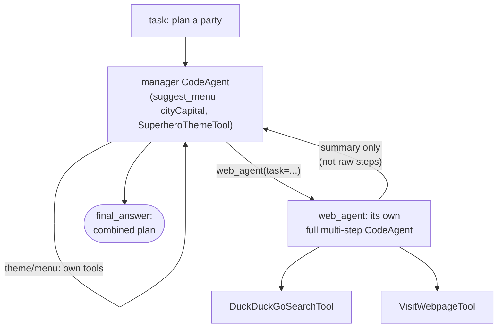

# Multi-agent systems

Course page: https://huggingface.co/learn/agents-course/en/unit2/smolagents/multi_agent_systems

A manager `CodeAgent` delegates work to a separate, specialized managed agent — each with its own tools, own memory, own `max_steps` — rather than one agent holding every tool.

## Files

- **`party_planner_multi_agent.py`** — `PartyPlannerManagerAgent`. Manager holds `suggest_menu`, `cityCapital`, `SuperheroThemeTool` directly; delegates web research to a managed `web_agent` (`DuckDuckGoSearchTool` + `VisitWebpageTool`) via `managed_agents=[...]`.

## Architecture



The manager never sees `web_agent`'s intermediate search/visit steps — only the summary it returns. That's what keeps the manager's own context small as tasks grow (the course's stated benefit of reduced token usage per step).

## Run it

```
python -m huggingface_agent.smolagents_course.multi_agent_systems.party_planner_multi_agent
```

## Two real bugs hit and fixed

1. **`UnicodeEncodeError: 'charmap' codec can't encode characters...`** — Windows' default console codepage (`cp1252`) can't print non-ASCII characters that real web content often contains (curly quotes, etc.), crashing the delegated call mid-print. Fixed with `sys.stdout.reconfigure(encoding="utf-8")` at the top of the script.
2. **`Code execution exceeded the maximum execution time of 30 seconds`** — a managed agent's *entire* multi-step sub-run counts as one single step from the manager's perspective, which can easily exceed `CodeAgent`'s default 30s per-step timeout. Fixed with `executor_kwargs={"timeout_seconds": 90}` on the manager.

Both confirmed fixed by re-running end to end: the manager successfully incorporated `web_agent`'s real researched song recommendation into the final plan instead of giving up and guessing one itself.
