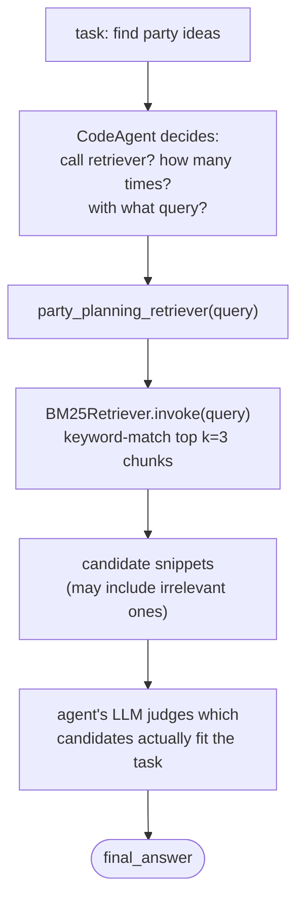

# Retrieval agents

Course page: https://huggingface.co/learn/agents-course/en/unit2/smolagents/retrieval_agents

"Agentic RAG": a `CodeAgent` whose only tool is a retriever over a local knowledge base, instead of a single fixed retrieval step bolted onto generation.

## Files

- **`party_planner_retrieval.py`** — `PartyPlannerRetrievalAgent` + `PartyPlanningRetrieverTool`. The tool wraps a `BM25Retriever` (keyword search, LangChain) built from 5 small party-planning snippets (`PARTY_IDEAS`), chunked via `RecursiveCharacterTextSplitter`.

## Run it

```
python -m huggingface_agent.smolagents_course.retrieval_agents.party_planner_retrieval
```

## Why "agentic" matters here



A naive RAG pipeline would just return BM25's #1 result. Here, the agent treats retrieved snippets as *candidates to reason over* — same pattern seen in `code_agents` when `suggest_menu`'s vague answer got overridden.

## What we verified hands-on

- **BM25 matches keywords, not meaning.** Query *"Find superhero party ideas, including a theme and a menu"* → correctly retrieved the superhero-themed menu snippet. But query *"Find kids party ideas..."* also pulled in an unrelated *"keep the menu casual for kids' parties"* snippet purely because the word "kids" now literally matched — nothing about actual relevance to a superhero party.
- **The agent's own LLM reasoning is what rescues this**, not the retriever: on the "kids" query, the agent still picked the superhero-themed answer over the casual one, apparently judging it fit "theme **and** menu" better — a real example of agentic RAG adding value over naive top-1 retrieval, though the exact selection logic isn't fully transparent (it's the LLM's judgment call, not a deterministic rule).
