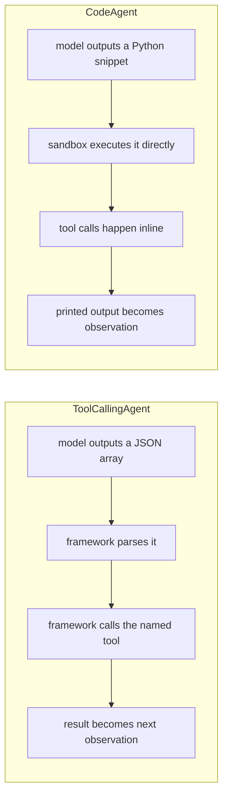

# ToolCallingAgents

Course page: https://huggingface.co/learn/agents-course/en/unit2/smolagents/tool_calling_agents

`ToolCallingAgent` produces JSON tool calls (the same `tools`/`tool_choice` mechanism as OpenAI/Anthropic-style function calling) instead of executable Python. Same outer step loop as `CodeAgent` — only the action format differs.

## JSON actions vs. code actions



## Files

- **`party_planner_tool_calling.py`** — `PartyPlannerToolCallingAgent`, reusing the *exact same tools* as `code_agents.party_planner.PartyPlannerAgent` (imported, not redefined), for an apples-to-apples comparison.

## Run it

```
python -m huggingface_agent.smolagents_course.tool_calling_agents.party_planner_tool_calling
```

## What we verified hands-on

- **Model/provider compatibility is not guaranteed.** `Qwen/Qwen2.5-Coder-32B-Instruct` (the default model used everywhere else in this project) **rejects** `ToolCallingAgent`'s requests on HF's Inference Providers router: first `400 INVALID_TOOL_CHOICE`, then `422 UNSUPPORTED_OPENAI_PARAMS: tools, tool_choice`. Switched the default model to `meta-llama/Llama-3.3-70B-Instruct`, which does support real function calling there.
- **Real side-by-side trace** (same task, same tools, through `PartyPlannerAgent` vs. this class): `suggest_menu(occasion="superhero")` returned the same vague string both times (`"Buffet with high-energy and healthy food."`). `CodeAgent` (Qwen) judged that too vague and improvised a detailed themed menu in Python (3 steps). `ToolCallingAgent` (Llama) passed the tool's literal answer straight to `final_answer` with no elaboration (2 steps). This is likely more a *model* difference than a pure *agent-architecture* difference — worth retesting with the same model on both agent types if that matters for your use case.

See the [JSON vs Code Actions](../code_agents/README.md) comparison in the `code_agents` README for the conceptual side of this; this folder is the empirical side.
