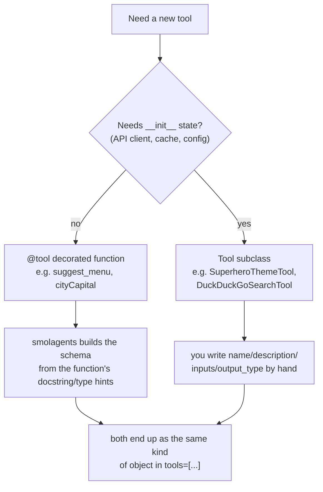

# Tools

Course page: https://huggingface.co/learn/agents-course/en/unit2/smolagents/tools

This page's content doesn't have a separate example file in this folder — a tool only means something in the context of an agent calling it, so the actual custom tools built for this course live in [`code_agents/party_planner.py`](../code_agents/party_planner.py). This folder exists to mirror the course's structure; see that file for the real, exercised examples.

## The two tool-definition patterns

- **`@tool`** — quick path. smolagents reads the function name, the docstring's first line, the `Args:` section, and the type hints to build the tool's JSON schema automatically.
- **`Tool` subclass** — manual path, needed when the tool has setup/state beyond its call arguments (see `DuckDuckGoSearchTool` building a `DDGS()` client in `__init__`, vs. `SuperheroThemeTool` which doesn't actually need the subclass form but demonstrates the pattern).

## How the model actually learns a tool exists

Every step, before calling the model, smolagents converts each tool into an OpenAI-style function schema (`get_tool_json_schema()` in `smolagents/models.py`) and attaches it to the request's `tools` field — fresh, every single call. The model has no persistent memory of a tool; remove it from `tools=[...]` and the model has zero awareness it ever existed (confirmed by watching the agent hallucinate a `wikipedia_search` tool that was never given to it, after `web_search` was removed).

## Project skill

See [`.claude/skills/add-smolagents-tool/SKILL.md`](../../../../.claude/skills/add-smolagents-tool/SKILL.md) for the repeatable recipe for adding a new tool to this project's agents.
