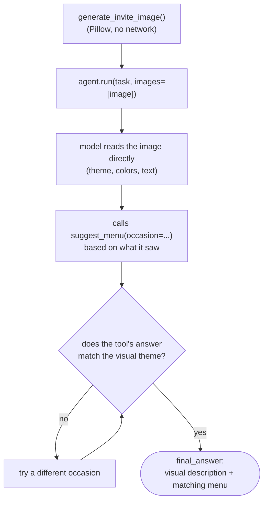

# Vision (and browser) agents

Course page: https://huggingface.co/learn/agents-course/en/unit2/smolagents/vision_agents

**Scoped to the VLM half only** — no live browser automation. The course's full example needs Chrome + `selenium` + `helium` (none installed) and GPT-4o via a separate OpenAI API key (not available in this environment). What's here is the part that doesn't need any of that: a `CodeAgent` that reasons over a real image.

## Files

- **`party_invite_vision.py`** — `generate_invite_image()` (draws a self-contained masquerade invitation with Pillow, no external image needed) + `PartyInviteVisionAgent` (a `CodeAgent` with the `suggest_menu` tool, given the image via `agent.run(task, images=[image])`).

## Run it

```
python -m huggingface_agent.smolagents_course.vision_and_browser_agents.party_invite_vision
```

## Flow



## Finding a model that actually works

Vision model availability on HF Inference Providers is inconsistent — two candidates failed before finding one that works:

| Model | Result |
|---|---|
| `meta-llama/Llama-3.2-11B-Vision-Instruct` | `400: not supported by any provider you have enabled` |
| `Qwen/Qwen2.5-VL-7B-Instruct` | Live on `featherless-ai`, but `503: temporarily at capacity` |
| `meta-llama/Llama-4-Scout-17B-16E-Instruct` | **Works** — live across 3 providers (novita, nscale, deepinfra) |

## What we verified hands-on

Given the generated invitation image (dark background, two red oval "mask eyes", gold triangle, text "GOTHAM ROGUES' BALL"), the agent:
1. Correctly described it as "dark, sophisticated, villainous... Gotham" — genuinely reading the image, not just the task text.
2. Called `suggest_menu(occasion="superhero")` → got a generic "high-energy buffet" answer.
3. **Judged that answer against what it saw in the image** and decided it didn't fit → retried with `occasion="formal"` instead, and used that result for the final answer.

Step 3 is the actual proof the agent is reasoning from the image, not just pattern-matching on the word "Gotham" in the task prompt.
