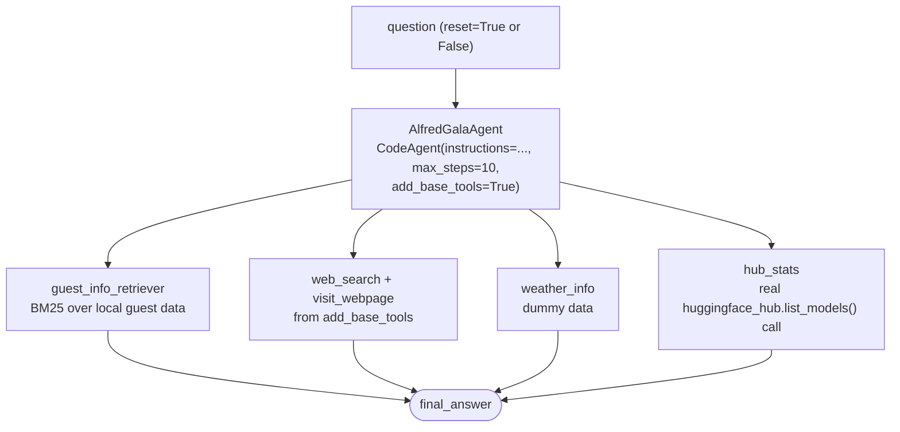

# Invitees, Tools & Agent

Course pages (all three build the **same** evolving project — `retriever.py`, `tools.py`, `app.py`, the course's own file names — not separate ones):
- https://huggingface.co/learn/agents-course/en/unit3/agentic-rag/invitees
- https://huggingface.co/learn/agents-course/en/unit3/agentic-rag/tools
- https://huggingface.co/learn/agents-course/en/unit3/agentic-rag/agent (final assembly)

The course shows the same pattern across all three Unit 2 frameworks via tabs (smolagents, LlamaIndex, LangGraph) — this builds the **smolagents** version, this project's primary framework.

## Files — mirroring the course's own layout

- **`retriever.py`** — `load_guest_docs()`, `build_guest_retriever()`.
- **`tools.py`** — `GuestInfoRetrieverTool` (invitees), `WeatherInfoTool`, `HubStatsTool` (tools).
- **`app.py`** — `AlfredGalaAgent`, the final assembly (agent page).
- **`invitees.json`** — a local saved copy of the guest dataset.
- **`eval_alfred.py`** — checks Alfred's answers against verifiable ground truth across all four tools, instead of trusting a few hand-picked examples.

## Run it

```
python -m huggingface_agent.unit3_agentic_rag.invitees.app
```

Run the eval:
```
python -m huggingface_agent.unit3_agentic_rag.invitees.eval_alfred
```

## The dataset is real, verified before writing anything against it — and saved locally

`agents-course/unit3-invitees` on the Hub — loaded directly and checked:
```
Rows: 3
Columns: ['name', 'relation', 'description', 'email']
First row: {'name': 'Ada Lovelace', 'relation': 'best friend', ...}
```
All 3 real guests: Ada Lovelace, Dr. Nikola Tesla, Marie Curie. Saved as `invitees.json` so `load_guest_docs()` doesn't hit the Hub every run (`from_hub=True` re-fetches).

## Alfred, fully assembled



`weather_info` uses the course's own dummy data deliberately (real weather is left as an exercise, e.g. via OpenWeatherMap as in Unit 1). `hub_stats` is a genuine API call, not dummy data.

**`add_base_tools=True`** provides `web_search`, `visit_webpage`, and `final_answer` automatically — confirmed an explicit `DuckDuckGoSearchTool()` alongside it is redundant (both are named `"web_search"`; the base one silently wins since the tools dict is keyed by name), so `app.py` only passes the three custom tools plus this flag instead.

**Conversation memory**: `AlfredGalaAgent.run(question, reset=False)` keeps the previous turn's context instead of starting fresh each call.

## A real behavioral bug, found via `eval_alfred.py` and fixed: dropped `planning_interval=3`

The course's own `planning_interval=3` made a simple *"tell me about our guest Marie Curie"* spiral into **12+ steps of open-ended web research** about the *historical* Marie Curie (Nobel prizes, WWI work, biography) instead of one `guest_info_retriever` call — **176,314 input tokens** on a single question before being killed. This wasn't random: it reproduced on a second full run too.

Debugging path, in order:
1. **Capped `max_steps=10`** — contained the token runaway (stopped at step 9 instead of climbing toward 20), but the agent *still* never called `guest_info_retriever` at all — it answered entirely from the model's own training knowledge via `web_search`, missing our actual guest record (no email in the answer).
2. **Added an explicit `instructions`** telling the model to always call `guest_info_retriever` first — made it *worse*: even the **initial plan**, generated before step 1, ignored the instruction entirely and went straight to `web_search`/`visit_webpage`.
3. **Removed `planning_interval=3` entirely** (keeping `instructions` + `max_steps=10`) — this was the actual fix. The plan-generation step `planning_interval` triggers doesn't incorporate `instructions` the same way normal steps do, so it was the real root cause, not just a contributing factor. Confirmed: the same question then resolved correctly in 2 steps.

**Takeaway worth keeping**: for a famous guest the model already "knows" a lot about, it's tempted to research them from general knowledge instead of trusting a local tool — `max_steps` only bounds the *cost* of that mistake, and `instructions` alone doesn't override `planning_interval`'s own plan-generation step. Removing `planning_interval` was what actually fixed the *behavior*.

## Two more real bugs, found and fixed in this folder

1. **`provider="featherless-ai"`** on `InferenceClientModel` — `Qwen/Qwen2.5-Coder-32B-Instruct`'s provider auto-resolution fails; recurring issue hit a total of 4 times across this project now (`langgraph_course/first_graph`, `smolagents_course/vision_and_browser_agents`, and twice in this file).
2. **`huggingface_hub.list_models()`'s removed `direction` kwarg** — the course's `list_models(..., direction=-1, limit=1)` raises `TypeError` on the installed version; confirmed via `inspect.signature()` that `direction` no longer exists at all. Fixed by dropping it — `sort="downloads"` alone already returns descending order now.

## Eval results: 4/6 (67%)

A real run of `eval_alfred.py`, after the `planning_interval` fix — all three guest-lookup cases correctly called `guest_info_retriever` first this time (no more runaway research), but two cases failed for a different, genuine reason:

| Case | Result | Why |
|---|---|---|
| `guest_ada_lovelace` | FAIL | Retrieval was correct (real email in the tool's observation) — but the model's own `final_answer()` kept only the `Description` field and dropped `Email` entirely. |
| `guest_nikola_tesla` | PASS | — |
| `guest_marie_curie` | PASS | — |
| `hub_stats_facebook` | PASS | `facebook/contriever`, matches the verified ground truth exactly. |
| `hub_stats_google` | FAIL | Retrieval was correct (`google/vit-base-patch16-224` in the tool's observation) — but the model wrote `most_downloaded_model_output.split(' ')[0]` to "extract the model name," which actually grabs the word `"The"` from `"The most downloaded model by google is..."`. Same category of bug as the Email-field issue in the tools-page commit: unreliable self-generated string parsing, not a retrieval problem. |
| `weather_tool_invoked` | PASS | — |

**The pattern across both failures**: the *tool call and retrieval* were correct in every single case — what failed was the model's own ad-hoc Python for formatting/extracting from an already-correct observation. This is a recurring, genuine finding across this project (also seen in the tools-page commit), not a one-off: `CodeAgent`'s generated post-processing code is noticeably less reliable than its tool selection and retrieval.

## What we verified hands-on (beyond the eval)

- **Conversation memory (`reset=False`)**: Turn 1 asked about Ada Lovelace; Turn 2 asked *"What projects is **she** currently working on?"* with no name given — the agent correctly resolved "she" to Ada Lovelace from Turn 1's context. It also handled the real-world mismatch sensibly (the historical Ada Lovelace isn't "currently working on" anything) by reinterpreting the question as "things named after her" instead of hallucinating fictional ongoing work.
- **Multi-tool use**: asked to prep for a conversation with Dr. Nikola Tesla — the agent retrieved his real guest record, then genuinely searched the web and returned real, current (2026) articles on wireless power transmission, not fabricated sources.

**Network flakiness encountered while testing** (not a code bug): some runs hit real `httpx.ReadTimeout` or `429` provider errors, or the auto-mode run-time limit, before finishing — same category of transient provider/network issues seen elsewhere in this project.
