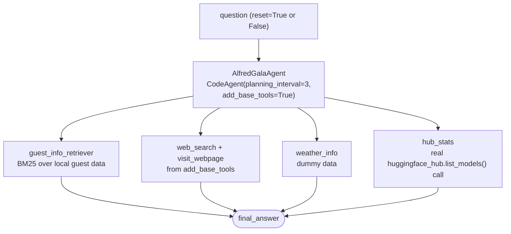

# Invitees, Tools & Agent

Course pages (all three build the **same** evolving project — `retriever.py`, `tools.py`, `app.py`, the course's own file names — not separate ones):
- https://huggingface.co/learn/agents-course/en/unit3/agentic-rag/invitees
- https://huggingface.co/learn/agents-course/en/unit3/agentic-rag/tools
- https://huggingface.co/learn/agents-course/en/unit3/agentic-rag/agent (final assembly)

The course shows the same pattern across all three Unit 2 frameworks via tabs (smolagents, LlamaIndex, LangGraph) — this builds the **smolagents** version, this project's primary framework.

## Files — mirroring the course's own layout

- **`retriever.py`** — `load_guest_docs()`, `build_guest_retriever()`.
- **`tools.py`** — `GuestInfoRetrieverTool` (invitees), `WeatherInfoTool`, `HubStatsTool` (tools).
- **`app.py`** — `AlfredGalaAgent`, the final assembly (agent page).
- **`invitees.json`** — a local saved copy of the guest dataset.

## Run it

```
python -m huggingface_agent.unit3_agentic_rag.invitees.app
```

## The dataset is real, verified before writing anything against it — and saved locally

`agents-course/unit3-invitees` on the Hub — loaded directly and checked:
```
Rows: 3
Columns: ['name', 'relation', 'description', 'email']
First row: {'name': 'Ada Lovelace', 'relation': 'best friend', ...}
```
All 3 real guests: Ada Lovelace, Dr. Nikola Tesla, Marie Curie. Saved as `invitees.json` so `load_guest_docs()` doesn't hit the Hub every run (`from_hub=True` re-fetches).

## Alfred, fully assembled



`weather_info` uses the course's own dummy data deliberately (real weather is left as an exercise, e.g. via OpenWeatherMap as in Unit 1). `hub_stats` is a genuine API call, not dummy data.

**`add_base_tools=True`** provides `web_search`, `visit_webpage`, and `final_answer` automatically — confirmed an explicit `DuckDuckGoSearchTool()` alongside it is redundant (both are named `"web_search"`; the base one silently wins since the tools dict is keyed by name), so `app.py` only passes the three custom tools plus this flag instead. **`planning_interval=3`** makes the agent re-plan every 3 steps on longer tasks.

**Conversation memory**: `AlfredGalaAgent.run(question, reset=False)` keeps the previous turn's context instead of starting fresh each call.

## Two real bugs, found and fixed in this folder

1. **`provider="featherless-ai"`** on `InferenceClientModel` — `Qwen/Qwen2.5-Coder-32B-Instruct`'s provider auto-resolution fails; recurring issue hit a total of 4 times across this project now (`langgraph_course/first_graph`, `smolagents_course/vision_and_browser_agents`, and twice in this file).
2. **`huggingface_hub.list_models()`'s removed `direction` kwarg** — the course's `list_models(..., direction=-1, limit=1)` raises `TypeError` on the installed version; confirmed via `inspect.signature()` that `direction` no longer exists at all. Fixed by dropping it — `sort="downloads"` alone already returns descending order now.

## What we verified hands-on

- **`hub_stats`**: `"What's the most downloaded model by facebook?"` → `facebook/contriever` with `8,292,281` downloads — matches a direct, independent API call made before writing the tool.
- **`guest_info_retriever`**: correctly retrieved Ada Lovelace's real record as the top match — **but** one run's final formatted answer had its `Email` field absorb the next guest's entire record too, because the `CodeAgent` wrote its own unbounded `.split("Email: ")[1]` parsing code. Not a tool/retriever bug — a real example of imperfect LLM-generated code, documented rather than hidden.
- **Conversation memory (`reset=False`)**: Turn 1 asked about Ada Lovelace; Turn 2 asked *"What projects is **she** currently working on?"* with no name given — the agent correctly resolved "she" to Ada Lovelace from Turn 1's context. It also handled the real-world mismatch sensibly (the historical Ada Lovelace isn't "currently working on" anything) by reinterpreting the question as "things named after her" instead of hallucinating fictional ongoing work.
- **Multi-tool use**: asked to prep for a conversation with Dr. Nikola Tesla — the agent retrieved his real guest record, then genuinely searched the web and returned real, current (2026) articles on wireless power transmission, not fabricated sources.

**Network flakiness encountered while testing** (not a code bug): one full 3-scenario run hit a real `httpx.ReadTimeout` partway through, and another hit the auto-mode run-time limit before finishing — same category of transient provider/network issues seen elsewhere in this project. Each individual capability above was confirmed with a focused, successful run; this is noted so a future failure on this exact command isn't mistaken for a regression.
