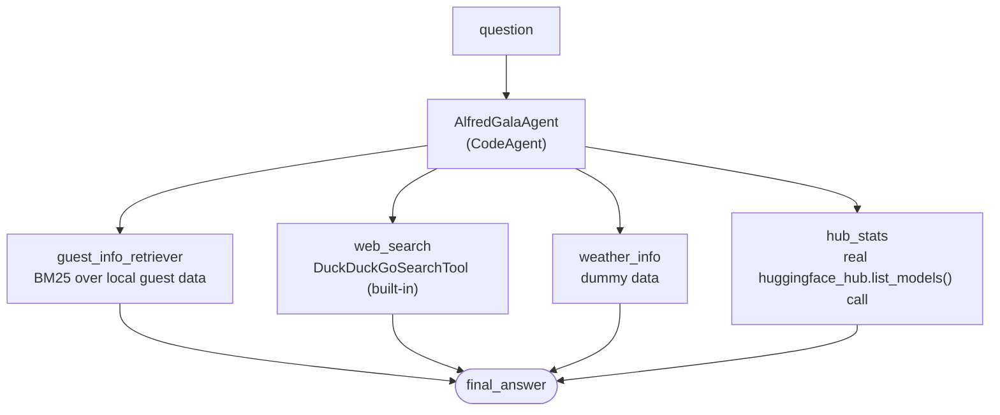

# Invitees & Tools

Course pages:
- https://huggingface.co/learn/agents-course/en/unit3/agentic-rag/invitees
- https://huggingface.co/learn/agents-course/en/unit3/agentic-rag/tools

Both pages build the **same** evolving project (`retriever.py`, `tools.py`, `app.py` — the course's own names), not separate ones, so this folder covers both. The course shows the same pattern across all three Unit 2 frameworks via tabs (smolagents, LlamaIndex, LangGraph) — this builds the **smolagents** version, this project's primary framework.

## Files — mirroring the course's own layout

- **`retriever.py`** — `load_guest_docs()`, `build_guest_retriever()`.
- **`tools.py`** — `GuestInfoRetrieverTool` (invitees), `WeatherInfoTool`, `HubStatsTool` (tools).
- **`app.py`** — `AlfredGalaAgent`, now wired with all four tools plus `DuckDuckGoSearchTool`.
- **`invitees.json`** — a local saved copy of the guest dataset.

## Run it

```
python -m huggingface_agent.unit3_agentic_rag.invitees.app
```

## The dataset is real, verified before writing anything against it — and saved locally

`agents-course/unit3-invitees` on the Hub — loaded directly and checked:
```
Rows: 3
Columns: ['name', 'relation', 'description', 'email']
First row: {'name': 'Ada Lovelace', 'relation': 'best friend', ...}
```
All 3 real guests: Ada Lovelace, Dr. Nikola Tesla, Marie Curie. Saved as `invitees.json` so `load_guest_docs()` doesn't hit the Hub every run (`from_hub=True` re-fetches).

## Alfred's four tools



`weather_info` uses the course's own dummy data deliberately (real weather is left as an exercise, e.g. via OpenWeatherMap as in Unit 1). `hub_stats` is a genuine API call, not dummy data.

## A real bug, found and fixed (second one in this folder): `huggingface_hub.list_models()`'s removed `direction` kwarg

The course's `HubStatsTool` calls `list_models(author=..., sort="downloads", direction=-1, limit=1)`. The installed `huggingface_hub` version has **removed `direction` entirely**:
```
TypeError: HfApi.list_models() got an unexpected keyword argument 'direction'
```
Checked the current signature directly (`inspect.signature(HfApi.list_models)`) — confirmed no `direction` parameter exists anymore. Tested `sort="downloads"` alone and confirmed it already returns descending order by default now, so the fix was simply dropping `direction=-1`, not finding a replacement for it.

(First bug in this folder was `provider="featherless-ai"` for `InferenceClientModel` — see the original note below, still applies.)

`Qwen/Qwen2.5-Coder-32B-Instruct` also needs `provider="featherless-ai"` explicitly on `InferenceClientModel` — same recurring provider-resolution issue hit three times elsewhere in this project (`langgraph_course/first_graph`, `smolagents_course/vision_and_browser_agents`, and earlier in this same file).

## What we verified hands-on

- **`hub_stats`**: `"What's the most downloaded model by facebook?"` → `facebook/contriever` with `8,292,281` downloads — matches a direct, independent API call made before writing the tool.
- **`guest_info_retriever`**: correctly retrieved Ada Lovelace's real record as the top match — **but** the final formatted answer's `Email` field accidentally absorbed the next guest's entire record too (`'ada.lovelace@example.com\n\nName: Marie Curie\n...'`). This isn't a bug in the tool or retriever — it's the `CodeAgent` writing its own naive `.split("Email: ")[1]` parsing code with no bound, catching everything after it including a second retrieved document. Worth knowing as a real example of imperfect LLM-generated code, not assumed away.
