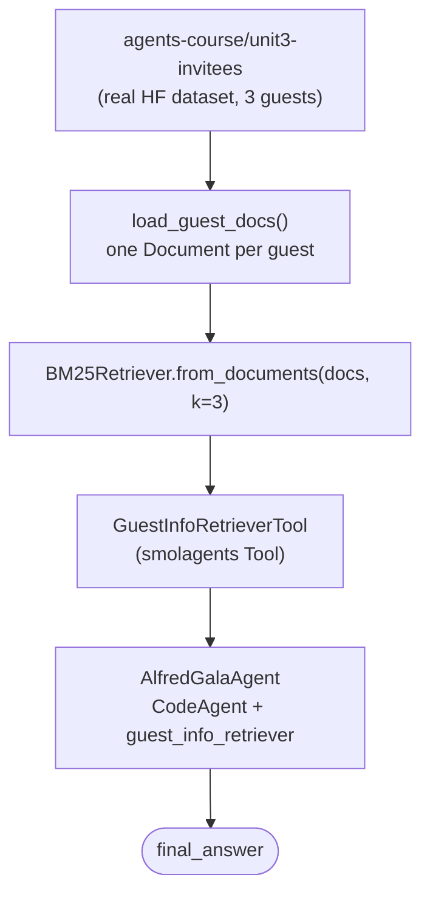

# Invitees

Course page: https://huggingface.co/learn/agents-course/en/unit3/agentic-rag/invitees

The start of Unit 3's capstone: "Alfred," an agent that helps host a gala. This page builds a BM25 guest-info retrieval tool over a real dataset. The course shows this same pattern across all three Unit 2 frameworks via tabs (smolagents, LlamaIndex, LangGraph) — this builds the **smolagents** version, this project's primary framework.

## Files — mirroring the course's own layout, for once

- **`retriever.py`** — `load_guest_docs()`, `build_guest_retriever()`.
- **`tools.py`** — `GuestInfoRetrieverTool`.
- **`app.py`** — `AlfredGalaAgent`.
- **`invitees.json`** — a local saved copy of the dataset (see below).

## Run it

```
python -m huggingface_agent.unit3_agentic_rag.invitees.app
```

## The dataset is real, verified before writing anything against it -- and now saved locally

`agents-course/unit3-invitees` on the Hub — loaded directly and checked:
```
Rows: 3
Columns: ['name', 'relation', 'description', 'email']
First row: {'name': 'Ada Lovelace', 'relation': 'best friend', ...}
```
Matches the course's described schema and example guest exactly — not assumed from the course text. All 3 real guests: Ada Lovelace, Dr. Nikola Tesla, Marie Curie.

Saved as `invitees.json` in this folder so `load_guest_docs()` doesn't hit the Hub on every run — `build_guest_retriever()` reads the local file by default; pass `from_hub=True` to re-fetch from the Hub instead (e.g. if the dataset is ever updated upstream).

## Flow



Same BM25-over-local-knowledge-base pattern as `smolagents_course/retrieval_agents`, applied to a real Hub dataset instead of hand-written text snippets.

## A real bug, found and fixed: `provider="featherless-ai"`

`Qwen/Qwen2.5-Coder-32B-Instruct` failed with the same `"not supported by any provider you have enabled"` error hit twice before in this project (`langgraph_course/first_graph`, `smolagents_course/vision_and_browser_agents`). Checked `model_info()` again — same root cause, its only live provider right now is `featherless-ai`. Fixed by passing `provider="featherless-ai"` explicitly to `InferenceClientModel`.

## What we verified hands-on

`alfred.run("Tell me about our guest named 'Lady Ada Lovelace'.")` → the agent called `guest_info_retriever(query="Lady Ada Lovelace")`, parsed the retrieved record, and returned the exact real data: name, relation (`"best friend"`), full description, and email — matching the dataset's actual row, not a hallucinated guess.
