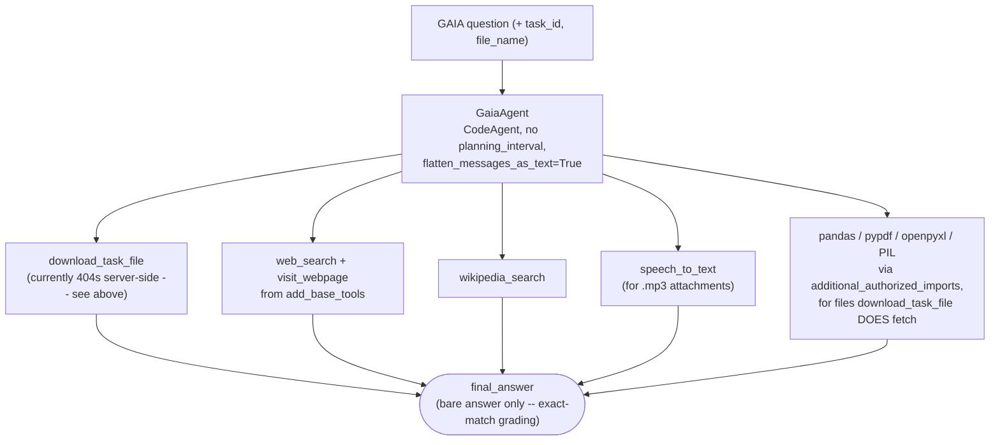

# Unit 4: Final Benchmark

Course pages:
- https://huggingface.co/learn/agents-course/en/unit4/introduction
- https://huggingface.co/learn/agents-course/en/unit4/hands-on

The final project: build an agent and score it against a subset of the **GAIA benchmark**, via the course's own scoring API. 30%+ earns the Certificate of Completion. Grading is **exact string match**, so answer formatting matters as much as correctness.

## This is not finance/stock-picking

An earlier idea for this unit was a stock-picking tool based on SPY holdings. Checked against the real course page before building anything: the benchmark is GAIA, a general-assistant benchmark (trivia, logic puzzles, file analysis, video/audio questions) — nothing finance-specific. Confirmed live by pulling the real question set (see below) before writing any code against it.

## Files

- `gaia_client.py` — `GaiaClient`: wraps the four scoring-API routes (`/questions`, `/random-question`, `/files/{task_id}`, `/submit`).
- `tools.py` — `DownloadTaskFileTool`: lets the agent fetch a task's attachment mid-reasoning.
- `app.py` — `GaiaAgent`: the CodeAgent that answers questions, tuned for exact-match grading.
- `dry_run.py` — runs the agent over all 20 real questions and prints each answer for manual inspection. **Not a submission.**

## The real question set, confirmed live (not assumed from the course text)

```
GET https://agents-course-unit4-scoring.hf.space/questions
```

20 questions, all Level 1:

| Type | Count | Examples |
|---|---|---|
| Text-only lookup/reasoning | 15 | Wikipedia facts, a reversed-sentence puzzle, a non-commutative-operation table puzzle, a grocery-list categorization task |
| Image attachment (.png) | 1 | A chess position — "find black's winning move" |
| Code attachment (.py) | 1 | "What is the final numeric output from the attached Python code?" |
| Audio attachment (.mp3) | 2 | Voicemail-style shopping-list questions |
| Spreadsheet attachment (.xlsx) | 1 | (within the lookup set above) |
| YouTube video | 2 | "In this video, what's the highest number of bird species on camera at once?" |

**Known gap, left as a gap rather than faked**: the 2 YouTube-video questions require watching video content, which this agent can't do. `GaiaAgent` is instructed to still guess rather than refuse (a guess can accidentally match; a refusal never does), but these aren't expected to score.

## Real bug found: `/files/{task_id}` 404s for every attachment

Tested directly against the live API before assuming the client code was wrong:

```
GET /files/cca530fc-4052-43b2-b130-b30968d8aa44
→ 404 {"detail":"No file path associated with task_id cca530fc-4052-43b2-b130-b30968d8aa44."}
```

Reproduced for all 5 attachment task_ids (the .png, both .mp3s, the .py, the .xlsx) — not one specific bad ID. This is a server-side gap in the hosted scoring mirror (`agents-course/Unit4_scoring`), not a bug in `GaiaClient.download_file`. Confirmed by calling the endpoint with plain `curl`, outside any of this project's code.

**Effect**: the 5 file-based questions are currently unanswerable via this API's own attachment route. `GaiaAgent` degrades gracefully instead of crashing — verified hands-on with the chess question: `download_task_file` reports the 404 as an observation, and the agent still calls `final_answer` with a best-effort guess rather than refusing.

## Retracted: what looked like a `featherless-ai` message-format bug was transient flakiness

`InferenceClientModel(model_id="Qwen/Qwen2.5-Coder-32B-Instruct", provider="featherless-ai")` — the same model+provider combo already used in `unit3_agentic_rag` — started failing every call in one investigation session with:

```
400 Bad Request: {"message": "The request was rejected as invalid...", "code": "bad_request"}
```

Isolated it to list-of-parts message `content` (`[{"type": "text", "text": ...}]`, the shape `InferenceClientModel` sends by default) by calling `InferenceClient.chat_completion()` directly, bypassing smolagents — plain string content worked, list-of-parts content 400'd, reproduced 3+ times across a bare `CodeAgent`, a raw client call, and the full `GaiaAgent`. At the time this looked like a deterministic incompatibility, and `flatten_messages_as_text=True` (which sends plain string content instead) made it go away.

**Retraction**: before touching `unit3_agentic_rag`'s otherwise-identical agent on the strength of this, re-ran the *exact same* raw list-of-parts call, with no code change — it succeeded 3/3. Re-ran the full `CodeAgent` without the flag 3 more times — also 3/3. The failure didn't recur. That means the original run of 400s was transient backend flakiness on featherless-ai's side that happened to coincide with the investigation window, not a real format incompatibility — the opposite mistake from the one already called out in `unit3_agentic_rag/invitees/README.md` (there, a reproducible bug was almost dismissed as "transient"; here, transient flakiness was almost written up as a reproducible bug). `flatten_messages_as_text=True` is left in `app.py` anyway since it's a harmless no-op, but it is **not** being applied to `unit3_agentic_rag`'s `AlfredGalaAgent` as a "fix," because there was never a confirmed bug to fix.

## Real finding (confirms a pattern from Unit 3): brittle self-generated parsing code, not retrieval, is the main failure mode

First run of the Mercedes Sosa discography question: the agent correctly found and read the right page, then wrote
```python
album_years = [line.split()[0] for line in discography_lines if line.strip().isdigit()]
```
to extract years from the scraped markdown — which silently matched **nothing** (lines look like `"2009 Cantora, un viaje íntimo"`, not bare `"2009"`), giving a confidently wrong answer of `0`.

This is the same category of bug documented in `unit3_agentic_rag/invitees/README.md` (the dropped Email field, the `.split(' ')[0]` bug): the model's tool selection and retrieval are reliable; its own ad-hoc string-parsing code on unstructured text is not.

**Mitigation, added to `app.py`'s instructions**: explicitly tell the model to *read and reason about* retrieved prose/markdown in its Thought step instead of writing parsing code for it, and reserve real parsing code for genuinely structured data (CSV/JSON/Excel). Re-ran the same question after this change — the agent switched to manually reading the discography and reasoning about which entries were real studio albums, instead of writing a regex/split heuristic. (It still landed on a different wrong count than the actual answer on this specific question — a genuinely ambiguous discography with re-releases and compilations — but the failure mode changed from "silently matches nothing" to "a defensible but incorrect manual read," which is the better failure to have under exact-match grading.)

## Architecture



No `planning_interval` — deliberately, from the start. `unit3_agentic_rag`'s capstone found that the plan-generation step it triggers ignores `instructions`, derailing a reliable tool-first approach into open-ended research. Same risk applies here, so it's left out rather than rediscovered.

## Run it

Sanity-check a single question:
```
python -m huggingface_agent.unit4_final_benchmark.app
```

Dry run across all 20 real questions (prints each answer, no submission):
```
python -m huggingface_agent.unit4_final_benchmark.dry_run
```

## What's NOT done yet: the actual submission

Scoring requires a public **Hugging Face Space** (duplicated from `agents-course/Final_Assignment_Template`) — the leaderboard needs a Gradio-login username plus a public Space code URL (`.../tree/main`) to verify against, not a GitHub repo. `GaiaClient.submit()` implements the `POST /submit` call, but nothing in this folder calls it: submitting is a one-way, publicly-visible action (logged against a real HF username, linked from the leaderboard), so it's left as a deliberate manual step rather than something run automatically. The remaining steps: duplicate the template Space, port this agent's logic into it, log in, and submit.

## Realistic expectations given what's verified above

Of the 20 questions: 15 text-only + 1 code-attachment (fully tractable), 2 audio (tractable via `speech_to_text`), 1 image + the YouTube-video 2 are currently out of reach (no working file download, no video tool). That's up to ~16 realistically answerable questions against a 30% (6/20) bar — headroom exists even assuming a meaningful fraction of individual answers come out wrong, as the Mercedes Sosa case shows can happen even with correct tool use.
